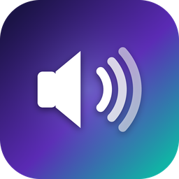
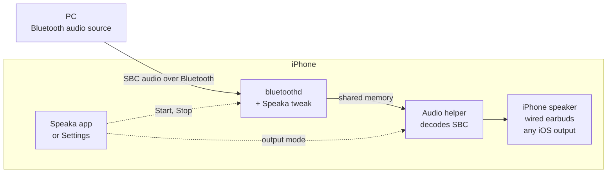
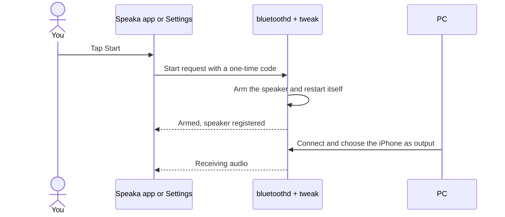
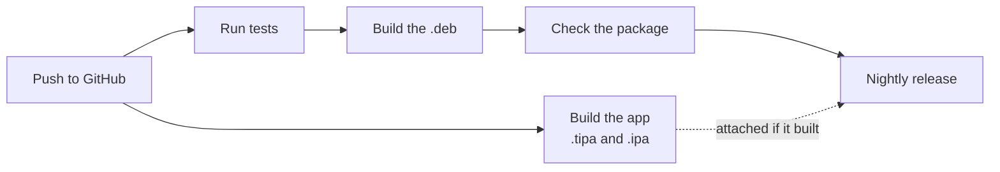

<p align="center">
  
</p>

<h1 align="center">Speaka</h1>

<p align="center">
  <b>Turn a jailbroken iPhone into a Bluetooth speaker for your PC.</b><br>
  Your PC lists the iPhone as a speaker. What it plays comes out of the iPhone's loudspeaker, wired earbuds, or any iOS output.
</p>

<p align="center">
  <a href="https://github.com/m9z2w4d8vw-blip/Speaka/actions/workflows/build.yml"></a>
  <a href="https://github.com/m9z2w4d8vw-blip/Speaka/releases"></a>
  
  
  
</p>

<p align="center">
  <a href="#quick-start"><b>Quick start</b></a> &nbsp;·&nbsp;
  <a href="#using-speaka"><b>Using Speaka</b></a> &nbsp;·&nbsp;
  <a href="#troubleshooting"><b>Troubleshooting</b></a> &nbsp;·&nbsp;
  <a href="#how-it-works"><b>How it works</b></a> &nbsp;·&nbsp;
  <a href="#building-and-testing"><b>Building</b></a>
</p>

---

iOS only implements the *sending* side of Bluetooth audio (A2DP Source): it can stream to headphones, but nothing can
stream to it. Speaka adds the *receiving* side (A2DP Sink), the role that speakers and headphones implement, to the
iPhone's Bluetooth daemon.

**Status:** working end to end with a Windows laptop. That covers connecting and streaming; pausing, resuming and
changing songs; switching outputs during playback; and wired earbuds without replugging.

> [!WARNING]
> Speaka is experimental. It changes how a system daemon behaves through undocumented internals, and it supports
> **exactly one** `bluetoothd` build, from iOS 17.0 (see [Requirements](#requirements)). On any other build it hooks
> nothing, so you get no speaker rather than a broken Bluetooth.

## Highlights

| | |
| --- | --- |
| 🔊 **One-tap Start and Stop** | From the Speaka app or Settings. Bluetooth restarts itself; your other devices reconnect on their own. |
| 🎧 **Your choice of output** | iPhone speaker, wired or USB headphones, or any iOS output, switchable mid-song. |
| 💻 **Live connection banner** | The app shows when your PC is connected and where the audio is playing. |
| 🛡️ **Safe by design** | Checks the exact Bluetooth build before hooking anything; every session ends at the next Bluetooth restart. |
| 🩺 **Built-in diagnostics** | One tap exports everything needed to diagnose a problem. |

## Requirements

| | |
| --- | --- |
| **iPhone** | iOS 17.0, arm64e. Developed on an iPhone 13. |
| **Jailbreak** | Rootless Dopamine with ElleKit and PreferenceLoader. TrollStore for the app. |
| **Sending device** | Any Bluetooth audio source that uses SBC. Developed with a Windows laptop. |

<details>
<summary><b>The exact <code>bluetoothd</code> build, and how Speaka checks it</b></summary>

<br>

| | |
| --- | --- |
| Size | 10,196,720 bytes, arm64e |
| SHA-256 | `e9408df54c3eebfd263eb745a0b06cf1130dd3228f56c104697f92264c91dbd6` |
| LC_UUID | `5491BA47-B5AE-3D44-9536-B30161DF1E90` |

The tweak hooks functions by address, and addresses only hold for one build. Before hooking, it checks the daemon's
LC_UUID and the first four instructions of every function it touches. On any mismatch it logs the reason and hooks
nothing. **Settings > Speaka > Status** (*Loaded in daemon: Yes - 5 hooks*) and the first block of the debug log show
whether it loaded. The package depends on `mobilesubstrate`, `preferenceloader` and `firmware (>= 14.0)`.

</details>

## Quick start

1. **Download** `Speaka_<version>_iphoneos-arm64.deb` and `Speaka.tipa` from the
   [**nightly** release](https://github.com/m9z2w4d8vw-blip/Speaka/releases). It's rebuilt on every push; `SHA256SUMS`
   lets you verify the files.
2. **Install the tweak.** Open the `.deb` with Sileo or Zebra, or run `sudo dpkg -i Speaka_*.deb` over SSH. Bluetooth
   restarts once, and Settings gains a **Speaka** page.
3. **Install the app.** Open `Speaka.tipa` with TrollStore. `Speaka.ipa` is the same file under another name.
4. **Start.** Open Speaka, or Settings > Speaka, and tap **Start**. Bluetooth restarts once more.
5. **Connect.** On the PC, pair with the iPhone (Windows: Settings > Bluetooth & devices > Add device > Bluetooth) and
   choose it as the sound output.

> [!IMPORTANT]
> Upgrading from a build older than v9.0? Its package had a different name, so remove it first. The steps are in
> [TESTING-v9.0](docs/history/TESTING-v9.0.md).

> [!NOTE]
> The app needs TrollStore. Sideloading it with AltStore or Sideloadly installs it, but strips the permissions it needs
> to reach the tweak. The app only controls the tweak, so the `.deb` is always required.

<details>
<summary><b>What the install script does, and how to uninstall</b></summary>

<br>

Installing registers the audio helper with launchd, creates `/tmp/FTABHarvest`, and restarts `bluetoothd` once, so the
new build is the one running. Installing alone does not turn the speaker on; that's what **Start** is for.

To remove Speaka, uninstall the package, which also unloads the helper. Then restart Bluetooth to unload the tweak:

```sh
sudo dpkg -r com.parv.speaka
sudo killall -9 bluetoothd
```

</details>

## Using Speaka

### The app

- **The connection banner** scrolls to the right and says what's happening, for example
  *LAPTOP-XXXX connected · playing on iPhone speaker*. It also warns when the output's volume is at zero.
- **Audio output** unfolds into the three outputs; the current one has a checkmark.
- **Start** and **Stop** sit at the bottom. While Bluetooth restarts, the button shows that it's working.
- **Credits** lists the app's credits and the license of its Dopamine-based user interface.

The app and **Settings > Speaka** read and write the same settings, so they always agree. More detail is in
[app/README.md](app/README.md).

### When to tap Start again

The speaker lasts as long as that run of Bluetooth. Tap **Start** again after any of these:

- a reboot, which on Dopamine also means re-jailbreaking;
- a userspace reboot;
- turning Bluetooth or Airplane Mode off and on. Settings then reads *Off - Bluetooth was turned off and on; tap Start*.

**Stop** restarts Bluetooth without the speaker, back to normal.

### Where the audio plays

**Audio output** in the app, or **Play audio on** in Settings, takes effect immediately, even mid-song:

| Mode | Plays on | Good to know |
| --- | --- | --- |
| **iPhone speaker** (default) | The built-in loudspeaker, always | Ignores plugged-in headphones. The most tested mode. |
| **Wired headphones or earbuds** | A wired or USB headset plugged into the iPhone | Never uses Bluetooth, so the sound can't go back to the PC. Waits while nothing is plugged in. |
| **Any device (follow iOS)** | Wherever iOS is playing | The mode for Bluetooth earbuds |

> [!TIP]
> For **Bluetooth earbuds**, choose *Any device* and pick the earbuds with **Choose output device...** or in Control
> Center. Your PC is itself a Bluetooth audio device to iOS, and since it connects last, iOS may send the sound back to
> it. If the banner shows your PC, pick the earbuds again.

### The Settings page

| Section | Rows |
| --- | --- |
| Status | Loaded in daemon, Last event, Log channels |
| Bluetooth speaker | Start, Stop and restore normal Bluetooth, Session |
| Audio output | Play audio on, Choose output device... |
| Debug log | View debug log, Copy log to clipboard, Clear log |
| Research switches | Leftovers from the research stages. **Start** sets the two one-shot switches for you, so leave these alone. |

## Troubleshooting

| Symptom | Likely cause | What to do |
| --- | --- | --- |
| Start ends with *Still waiting* | Bluetooth still runs an older tweak build without the Start handler | Reinstall the package (its install script restarts Bluetooth), or run `sudo killall -9 bluetoothd`. Then Start again. |
| *Off - Bluetooth was turned off and on; tap Start* | Toggling Bluetooth rebuilt Apple's endpoints without the speaker | Tap **Start**. |
| The PC connects and drops at once, or finds no speaker | No speaker registered since the last Bluetooth restart | Tap **Start**, then reconnect from the PC. |
| The PC plays, the iPhone is silent, and the banner shows your PC | *Any device* is sending the sound back to the PC | Choose *iPhone speaker* or *Wired headphones*, or pick your earbuds with **Choose output device...**. |
| Control Center keeps switching between *Headphones* and your PC, and nothing plays | Builds before v9.1 restarted their audio on every stream change, and each restart re-routed iOS ([TESTING-v9.1](docs/history/TESTING-v9.1.md)) | Update to v9.1. If it still happens, save the log right away. |
| The banner says the volume is at 0% | That output's volume is at zero | Raise the iPhone volume while audio plays. |
| Wired mode is silent and the banner says it's waiting | Nothing is plugged in | Plug the headset in; playback starts by itself. |
| The sound stopped after a call, Siri or another app | iOS interrupted playback | Pause and play on the PC, or change any audio setting. |
| Bluetooth misbehaves in general | | Tap **Stop**. Without the app or Settings: `sudo killall -9 bluetoothd`. To remove everything, uninstall. |

When something goes wrong, open **View debug log** right away and use **Save Log to iCloud Drive**.

## Logs and diagnostics

**View debug log** in Settings gathers everything in one place:

- the tweak's status;
- its log;
- an **AUDIO HELPER** section with the output mode, the helper's last status (state, device, volume) and its own log.

**Copy log to clipboard** and **Save Log to iCloud Drive** export the same text.

<details>
<summary><b>Log files, copying them to a PC, and the lines worth knowing</b></summary>

<br>

| File | Written by | Notes |
| --- | --- | --- |
| `/tmp/FTABHarvest/Speaka.log` | The tweak inside `bluetoothd` | Cleared past 512 KB; the last 480 lines are mirrored into preferences for Settings. Traffic is summarized every 2 s. |
| `/tmp/FTABHarvest/BTPSAudioHelper-v88.log` | The audio helper | Timestamped like the daemon log. It grows indefinitely; Settings reads only its tail. |

```powershell
scp mobile@<iphone-ip>:/tmp/FTABHarvest/Speaka.log "$env:USERPROFILE\Downloads\"
scp mobile@<iphone-ip>:/tmp/FTABHarvest/BTPSAudioHelper-v88.log "$env:USERPROFILE\Downloads\"
```

| Line | Meaning |
| --- | --- |
| `diag.v89.build: v9.1.0-one-tap-output-select` | The tweak build running inside `bluetoothd` |
| `diag.v89.session: start nonce=... result=ARMED` | Start restarted Bluetooth and armed the speaker |
| `diag.v82.sep: LOCAL register=0 SEID=7 role=SNK ...` | The speaker endpoint is registered |
| `V88_CONFIG handle=1 local_seid=7 remote_seid=...` | The PC configured a stream |
| `V88_STREAM active=1 generation=N` | The stream started (`active=0`: paused or closed) |
| `V893_RX 2000ms forwarded=... ok=... decoded=... bad=...` | Two seconds of reception; errors are also logged individually |
| `V881_PCM ... peak=... \| RENDER ... silence_frames=...` | Audio level, and underruns (`silence_frames`) |
| `V882_HEALTH ready=0 ... why=0x20` | Helper health. `0x1` stream inactive, `0x2` no queue, `0x4` queue stopped, `0x8` stopping, `0x10` enqueue error, `0x20` wrong output for the mode |
| `V882_IDLE_GUARD action=keep` | The guard kept the stream alive instead of iOS's idle suspend |
| `V82 TX_SIGNAL ... msg=0 sig=9` / `V82 RX_SIGNAL ... msg=0 sig=9` | The phone / the PC paused the stream (`sig=7` start, `sig=8` close) |
| `V882_CONTROL ... by=phone` / `by=pc` | Who started or suspended the stream. `by=phone` is Apple's own code treating the PC as an output |
| Helper `V889_AUDIO_ROUTE stage=... mode=... type=... name=...` | Exactly where the audio went |
| Helper `V882_AUDIO_STOP reason=...` | Why the helper stopped playing |
| Helper `V882_INTERRUPTION type=began reason=...` | iOS interrupted playback |
| Helper `V91_SESSION active=... why=...` | The helper's audio session changed. Expect one per playback, not one per second |
| Helper `V91_STREAM_CHANGE ... output=kept` / `V91_START_DEFERRED reason=...` | A stream change that kept playing / why playback is waiting |

Offline helpers in `tools/`:

| Script | Purpose |
| --- | --- |
| `fetch_google_sbc.sh` | Fetches Google libsbc at the pinned commit (CI runs it) |
| `decode_rtp_sbc.py` | Decodes captured A2DP RTP/SBC packets |
| `sdp_record.py` | Builds and decodes the Audio Sink SDP record (used by the tests) |
| `inspect_bluetoothd.py` | Read-only evidence collector for a `bluetoothd` binary |
| `triage_log.py` | Interprets logs from the early (v5/v6) builds |
| `windows_bluetooth_snapshot.ps1` | Read-only snapshot of the PC's Bluetooth state |

</details>

## How it works



Inside the Bluetooth daemon, the tweak adds one Sink endpoint next to Apple's six Source endpoints and advertises the
iPhone as an audio sink. The PC then sees a speaker. Incoming audio goes through shared memory to a separate helper
process, which decodes it and plays it on the output you chose. Apple's own Bluetooth handling stays untouched.

Starting the speaker works like this:



<details>
<summary><b>Technical details: hooks, design, the audio helper and the shared names</b></summary>

<br>

**Hooks.** `Tweak.xm` is loaded into `bluetoothd` (filter: `Speaka.plist`). Its five offset hooks come from
`BTPSBuild.h`, and each target is verified before hooking. Two do the work; three are pass-through observers.

| Function | Offset | Role |
| --- | --- | --- |
| `AVDTP_RegisterMultipoint` | `0x00cecf0` | Watches Apple's six Source registrations, then registers the Sink endpoint |
| `SetConfigInd_handler` | `0x037ae68` | Learns the stream handle and endpoint IDs when the PC configures a stream |
| `advertise_A2DP_source` | `0x044df14` | Observer |
| `SetConfig_accept_SBC` | `0x03b03b4` | Observer (logs the accepted SBC configuration) |
| `publish_audio_device` | `0x0376e4c` | Observer |

**Design, step by step:**

1. **A seventh endpoint slot (v8.1).** AVDTP is configured for six endpoints, all used by Apple's Sources. A one-shot
   shadow of its configuration (getter index 3) makes room for a seventh.
2. **The speaker endpoint (v8.2).** After the six Sources register, the tweak registers one Sink (TSEP 1, SEID 7, SBC)
   and a local SDP Audio Sink record (UUID `0x110B`). A small state machine (`BTPSV88Control.c`) tracks the stream.
3. **Media (v8.8).** Apple's stream callback table has 27 pointer-authenticated entries. The tweak copies it and
   replaces only slot `+0xb0`, a no-op stub at `+0x385dfc`. Each packet lands in a ring of 32 × 2048-byte slots in
   locked shared memory, with no locks, allocation, logging or system calls on Bluetooth's receive thread.
4. **A worker thread** connects to the helper, drains the log and event queues, and keeps the helper's health lease
   every 20 ms.
5. **The idle guard (v8.8.2).** iOS's idle check at `+0x376034` would suspend a stream that iOS itself isn't playing.
   While the helper is healthy, the guard keeps the stream; otherwise Apple's decision stands.
6. **Start and Stop (v8.9.2).** The app or Settings writes `{action, nonce, time}` and posts
   `com.parv.speaka.v89.session`. The tweak validates it, sets the one-shot switches and restarts `bluetoothd` by
   ending itself. It runs as `mobile`, so it can't use `launchctl kickstart`. launchd relaunches it, armed.
7. **Bluetooth toggles (v8.9.2).** Turning Bluetooth off and on re-runs Apple's endpoint registration without the
   Sink. The tweak notices, stops forwarding and reports it.

**The audio helper.** `BTPSAudioHelper` (`btpsaudiohelper/`) runs outside `bluetoothd`. It's started by the launchd job
`com.parv.speaka.audio` on `127.0.0.1:37594`, as user `mobile`, on the first stream. It decodes with Google libsbc and
plays through AudioQueue. Nothing records, and no input is ever opened.

| Mode | AVAudioSession setup |
| --- | --- |
| iPhone speaker | PlayAndRecord with DefaultToSpeaker, plus a speaker override |
| Wired headphones or earbuds | PlayAndRecord with no Bluetooth option, so only wired or USB outputs qualify |
| Any device | Playback, which follows iOS |

The route policy is plain C in `BTPSV89Output.h`, tested directly. The helper also does these things:

- services its run loop, so route changes and interruptions arrive;
- clears an interruption when a new stream starts;
- reports its health every ~0.2 s;
- publishes its status for the app and Settings;
- keeps its output through stream changes, lets go only after 8 s without audio, and never re-activates its session
  faster than every 3 s (v9.1, `btpsaudiohelper/BTPSV91Hold.h`).

**Shared names.** Everything below lives in `BTPSShared.h`, so the tweak, the helper, Settings and the app always
agree.

| Name | Kind | Purpose |
| --- | --- | --- |
| `SpeakaStatus`, `SpeakaLog` | Preference | The tweak's status and log for Settings and the app |
| `SpeakaV89SessionRequest` / `...SessionPending` | Preference | A Start/Stop request, carried across the restart |
| `com.parv.speaka.v89.session` | Darwin notification | "A session request is waiting" |
| `SpeakaV81SevenOnce`, `SpeakaV82DecisiveOnce` | Preference | The one-shot switches that Start sets and the next launch consumes |
| `SpeakaV89OutputMode` | Preference | `speaker`, `headphones` (wired) or `any` |
| `com.parv.speaka.v89.output` | Darwin notification | The output setting changed |
| `SpeakaV89HelperStatus` | Preference | The helper's state, outputs and volume |
| `127.0.0.1:37594` | TCP (launchd socket) | The daemon's connection to the helper |
| `/tmp/FTABHarvest/` | Directory | The shared ring file and both logs |

</details>

## Repository layout

```text
.
├── Tweak.xm, BTPS*.c/.h       the tweak loaded into bluetoothd (built by ./Makefile)
│   ├── BTPSBuild.h                offsets and signatures of the supported bluetoothd build
│   ├── BTPSV88*.c/.h              shared ring, stream control, worker, health lease
│   ├── BTPSV89Session.c/.h        Start and Stop
│   └── BTPSShared.h               names shared by the tweak, the helper, Settings and the app
├── SBCSink.mm, sbc_decode.c   the original in-daemon decoder (inactive; see Known limitations)
├── Makefile, control, Speaka.plist
├── btpsaudiohelper/           the audio helper: decoding and playback
├── speakaprefs/               the Settings page
├── app/                       the Speaka app, packaged as Speaka.tipa / Speaka.ipa
├── layout/                    install scripts, the helper's launchd job, the Settings entry
├── tests/                     the test suite (many tests compile the real C sources)
├── tools/                     offline scripts
├── docs/                      release notes (history/), research findings (research/), images
└── .github/workflows/         CI: test, build, package, publish
```

Shared sources exist once, at the root. A subproject that needs one holds a one-line `#include "../file.c"`, so the
copies can't drift apart. `tests/test_repo_layout.py` fails CI with an explanation in any of these cases:

- a file lands in the wrong folder;
- a `(1)` duplicate appears;
- a root source becomes unused;
- a README link breaks.

## Building and testing



Every push runs `.github/workflows/build.yml` on macOS with Xcode and Theos. The tweak job does four things:

1. fetches the pinned libsbc;
2. runs every test;
3. builds and checks the `.deb`;
4. uploads it as the `Speaka-deb` artifact.

A separate job builds the app as the `Speaka-app` artifact. Pushes to `main` republish the **nightly** release with
all three files and `SHA256SUMS`. If the app fails to build, the release still goes out with the `.deb`. A tag such as
`v0.2.0` publishes a versioned release. Package versions are `control`'s version plus the run number, so every build
is newer than the last.

<details>
<summary><b>Building locally, running the tests, and porting</b></summary>

<br>

You need macOS with Xcode and [Theos](https://theos.dev):

```sh
export THEOS=~/theos
bash tools/fetch_google_sbc.sh       # Google libsbc at the pinned commit
make clean package FINALPACKAGE=1    # packages/com.parv.speaka_*.deb (rootless, arm64 + arm64e)
make -C app tipa FINALPACKAGE=1      # app/packages/Speaka.tipa and Speaka.ipa
```

The build is rootless only. `BTPS_WITH_PREFS=0` skips the Settings bundle; `BTPS_WITH_IPC_HELPER=0` skips the audio
helper, which leaves you without audio.

```sh
python3 -m unittest discover -s tests -v
BTPS_SANITIZE=1 python3 -m unittest discover -s tests    # AddressSanitizer + UBSan where tests compile C
```

The tests check the sources statically, or compile the real C files with the host compiler: the shared ring, the log
summarizer, the route policy and the SBC decoders. The SDP record is checked against a Python model. The decoder and
runtime tests need libsbc, so run `tools/fetch_google_sbc.sh` first; without it, `test_v88_runtime` fails by design.

**Porting** to another iOS build means re-deriving every offset and signature in `BTPSBuild.h` and `Tweak.xm`.
`docs/research/` and [PROVENANCE-v8.2](docs/history/PROVENANCE-v8.2.md) record how each was found, and
`tools/inspect_bluetoothd.py` collects the evidence.

</details>

## Safety and recovery

> [!CAUTION]
> If Bluetooth misbehaves, recover in this order, from least to most drastic:
>
> 1. **Stop** in the app, or **Stop and restore normal Bluetooth** in Settings.
> 2. `sudo killall -9 bluetoothd`.
> 3. Uninstall the package.

Three design choices limit what can go wrong:

- The tweak refuses to hook a build it wasn't made for.
- It leaves Apple's own signaling and Source endpoints alone.
- Every speaker session is one-shot: the switches are consumed at launch, so the next Bluetooth restart always comes
  back as normal Bluetooth.

## Known limitations

- **One `bluetoothd` build**, from iOS 17.0.
- **One session per Bluetooth run.** Tap Start again after a restart or a Bluetooth toggle.
- **SBC only, one stream at a time.** The Windows laptop it was developed with sends SBC at its best standard
  setting (about 328 kbps); AAC isn't supported yet.
- **Playback is controlled from the PC.** There are no media controls on the iPhone.
- **Bluetooth earbuds are less tested.** iOS may switch the sound back to the PC when it reconnects, and receiving
  and sending audio at the same time hasn't been tested on a device.
- **iOS lists the PC as an output.** That comes from bluetoothd and is not fixed. If the phone suspends the stream
  as playback starts, the sound begins once Windows reopens the stream, about 6 s later.
- **Inactive legacy code** (the first design's in-daemon decoder and the v7 self-tests) is still compiled into the
  tweak.

## Version history

Each version's notes explain what changed, why, and how it was tested on the device. There are no v8.4 or v8.5
notes.

<details>
<summary><b>All versions, and the reverse-engineering notes</b></summary>

<br>

| Version | Milestone | Notes |
| --- | --- | --- |
| v5 | First on-device checklist for the hook build | [TESTING-v5](docs/history/TESTING-v5.md) |
| v6 | Device testing procedure | [TESTING-v6](docs/history/TESTING-v6.md) |
| v7 | Optional SDP registration observation | [TESTING-v7](docs/history/TESTING-v7.md) |
| v7.1 | iCloud log export, SDP research, receive-side media foundation | [TESTING-v7.1](docs/history/TESTING-v7.1.md) |
| v7.2 | Verified test sequence | [TESTING-v7.2](docs/history/TESTING-v7.2.md) |
| v7.3 | Cross-process PCM playback in a separate helper | [TESTING-v7.3](docs/history/TESTING-v7.3.md) |
| v7.4 | `bluetoothd` to an independent audio helper | [TESTING-v7.4](docs/history/TESTING-v7.4.md) |
| v7.5 | Compressed RTP/SBC from `bluetoothd` to the helper | [TESTING-v7.5](docs/history/TESTING-v7.5.md) |
| v7.6 | Decode captured SBC and play it from the helper | [TESTING-v7.6](docs/history/TESTING-v7.6.md) |
| v7.6.1 | Helper playback diagnostics and limited gain | [TESTING-v7.6.1](docs/history/TESTING-v7.6.1.md) |
| v7.7 | Two-phase Sink endpoint capacity trial | [TESTING-v7.7](docs/history/TESTING-v7.7.md) |
| v7.8 | Read-only AVDTP capacity audit | [TESTING-v7.8](docs/history/TESTING-v7.8.md) |
| v7.9 | Read-only allocation geometry audit | [TESTING-v7.9](docs/history/TESTING-v7.9.md) |
| v8.0 | AVDTP configuration lookup timing probe | [TESTING-v8.0](docs/history/TESTING-v8.0.md) |
| v8.1 | One-shot seven-slot AVDTP capacity | [TESTING-v8.1](docs/history/TESTING-v8.1.md) |
| v8.2 | Live native Sink signaling: SEID 7 and SDP `0x110B` | [TESTING-v8.2](docs/history/TESTING-v8.2.md), [PROVENANCE-v8.2](docs/history/PROVENANCE-v8.2.md) |
| v8.3 | Post-Source audio context | [TESTING-v8.3](docs/history/TESTING-v8.3.md) |
| v8.6 | Receive-only media channel trial | [TESTING-v8.6](docs/history/TESTING-v8.6.md) |
| v8.7 | Raw media-handler entry counter | [TESTING-v8.7](docs/history/TESTING-v8.7.md) |
| v8.8 | **Continuous audio** through shared memory to the helper | [TESTING-v8.8](docs/history/TESTING-v8.8.md) |
| v8.8.1 | Speaker route | [TESTING-v8.8.1](docs/history/TESTING-v8.8.1.md) |
| v8.8.2 | Native idle-check guard | [TESTING-v8.8.2](docs/history/TESTING-v8.8.2.md) |
| v8.9 | One-tap Start/Stop and audio output selection | [TESTING-v8.9](docs/history/TESTING-v8.9.md) |
| v8.9.1 | Superseded by v8.9.2 (its restart approach was wrong) | [TESTING-v8.9.1](docs/history/TESTING-v8.9.1.md) |
| v8.9.2 | Start reaches the tweak; Bluetooth toggles are detected | [TESTING-v8.9.2](docs/history/TESTING-v8.9.2.md) |
| v8.9.3 | Logs that cover the whole session and show where the audio went | [TESTING-v8.9.3](docs/history/TESTING-v8.9.3.md) |
| v8.9.4 | Wired earbuds without replugging; switching outputs without reconnecting | [TESTING-v8.9.4](docs/history/TESTING-v8.9.4.md) |
| v9.0 | **Renamed to Speaka** throughout: package `com.parv.speaka` and new internal names | [TESTING-v9.0](docs/history/TESTING-v9.0.md) |
| v9.1 | No more Headphones / PC flicker: the helper keeps its output through stream changes | [TESTING-v9.1](docs/history/TESTING-v9.1.md) |

| Research note | Topic |
| --- | --- |
| [V5_STATIC_FINDINGS](docs/research/V5_STATIC_FINDINGS.md) | Static disassembly landmarks |
| [V6_SDP_AND_MEDIA_PLAN](docs/research/V6_SDP_AND_MEDIA_PLAN.md) | Plan for Sink discovery and incoming audio |
| [V7_SDP_REVERSE_ENGINEERING](docs/research/V7_SDP_REVERSE_ENGINEERING.md) | SDP record-add instrumentation |
| [V7_1_MEDIA_PATH](docs/research/V7_1_MEDIA_PATH.md) | Receive side: RTP packets to stereo PCM |
| [V78_AVDTP_CAPACITY_FINDINGS](docs/research/V78_AVDTP_CAPACITY_FINDINGS.md) | `AVDTP_RegisterMultipoint` and the origin of error `0x68` |
| [V79_AVDTP_ALLOCATION_FINDINGS](docs/research/V79_AVDTP_ALLOCATION_FINDINGS.md) | Where the six-entry AVDTP table comes from |
| [V83_BINARY_PROVENANCE](docs/research/V83_BINARY_PROVENANCE.md) | Audio-context expansion: binary provenance |

</details>

## Credits

- [**Google libsbc**](https://github.com/google/libsbc) (Apache-2.0) decodes the audio. It's fetched at build time at
  commit `6e505650145c9973d08a0bdd5e5f5e1914305e40` and isn't committed.
- The app's user interface is adapted from [**Dopamine**](https://github.com/opa334/Dopamine) by Lars Fröder (opa334)
  and its contributors, under the MIT License, which ships in the app under **Credits**.
- `sbc_decode.c` is the project's own SBC decoder, written from the Bluetooth specification and used by the tests.
- Built with [**Theos**](https://theos.dev). It runs on Dopamine with ElleKit and PreferenceLoader.
